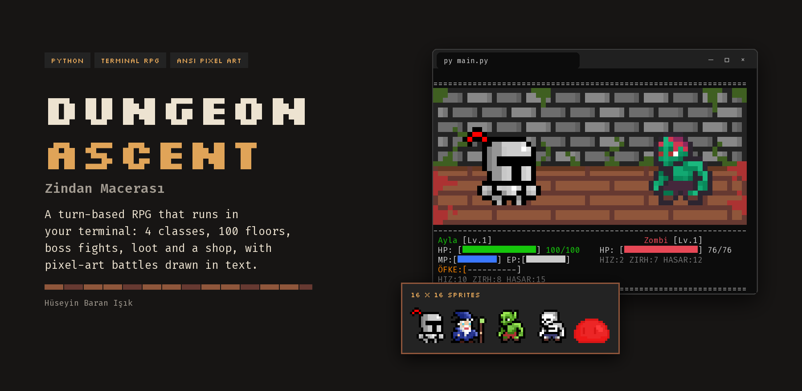
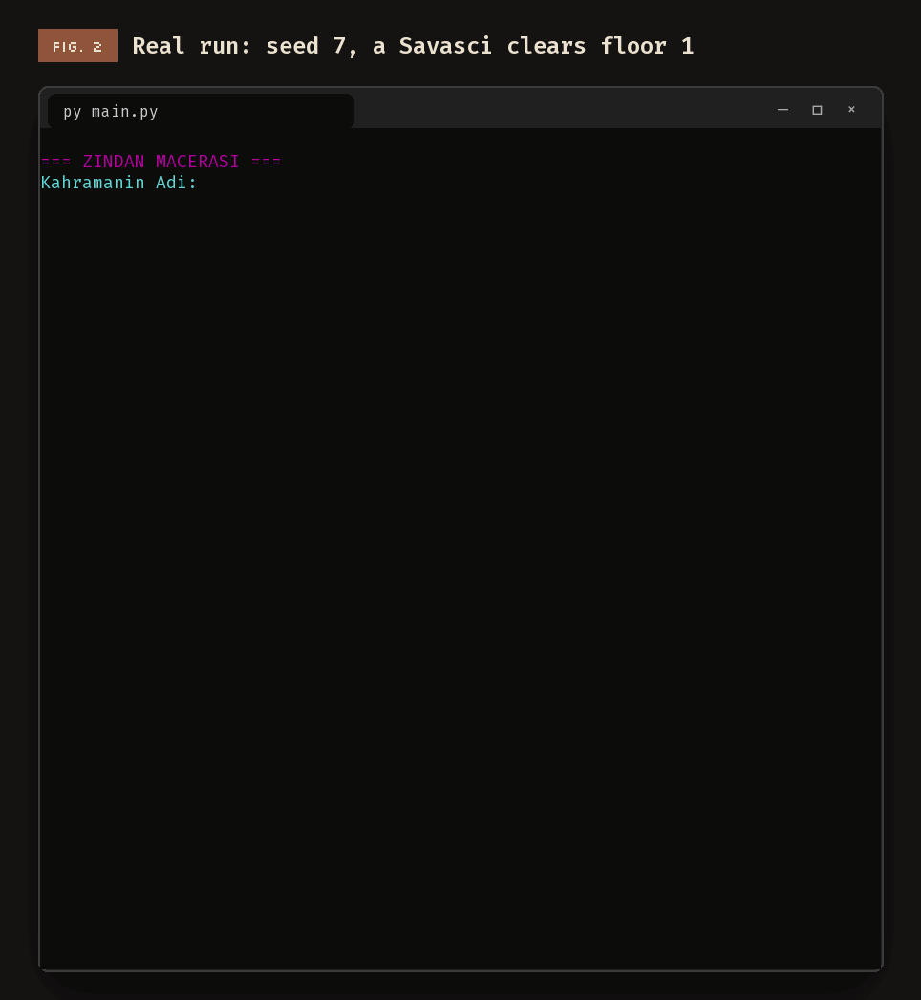
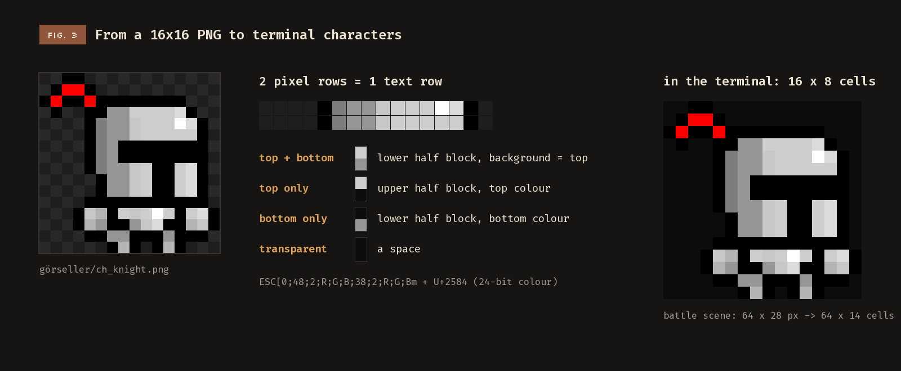
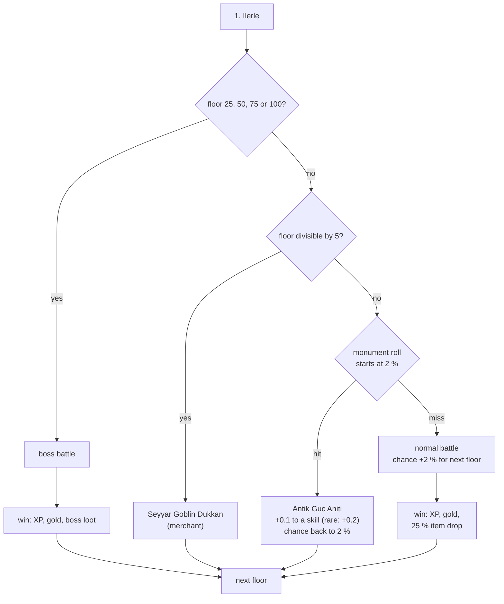
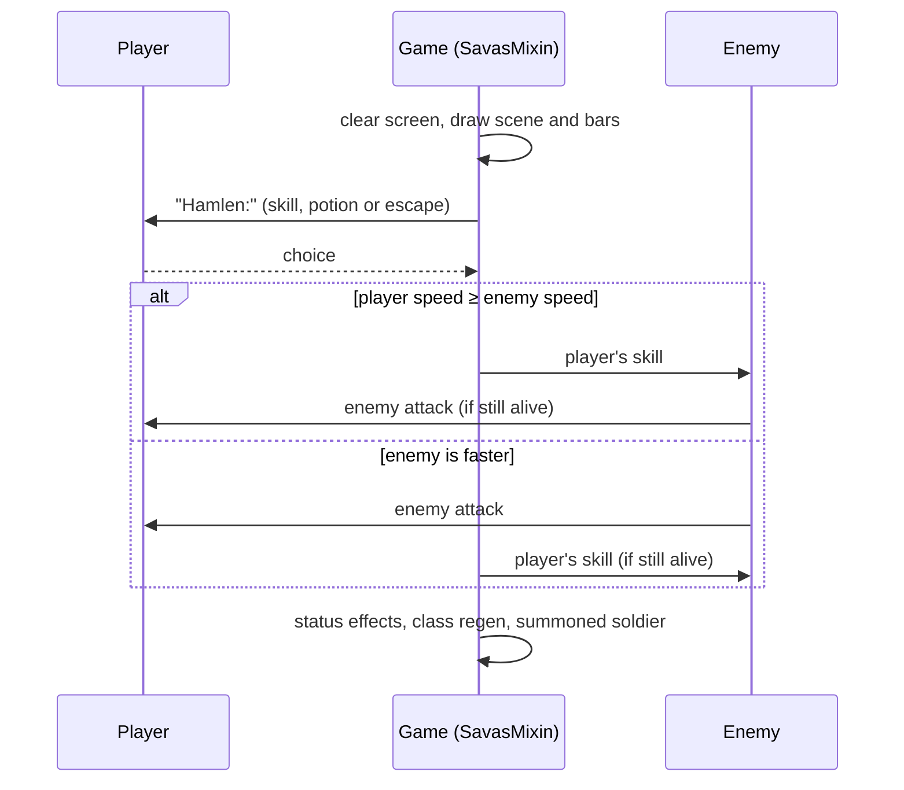
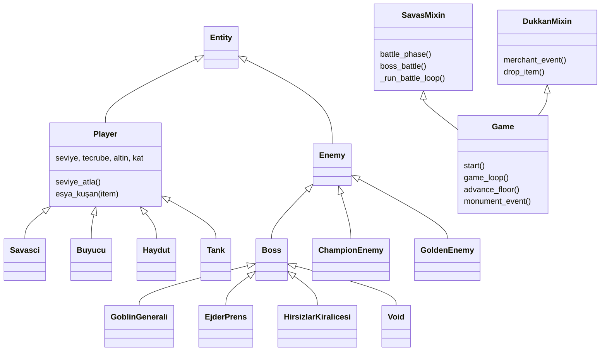

<p align="center">
  
</p>

<p align="center">
  <a href="#demo">Demo</a> &nbsp;·&nbsp;
  <a href="#what-it-does">What it does</a> &nbsp;·&nbsp;
  <a href="#how-it-works">How it works</a> &nbsp;·&nbsp;
  <a href="#run-it">Run it</a> &nbsp;·&nbsp;
  <a href="#known-limits">Limits</a> &nbsp;·&nbsp;
  <a href="#türkçe">Türkçe</a>
</p>

**Dungeon Ascent** (*Zindan Macerası*) is a turn-based RPG that runs in a terminal. You pick one of four classes
and climb a dungeon floor by floor: fights, merchants, ancient monuments, loot, and a boss every 25 floors. The
battles are pixel art, drawn with coloured text characters, and the game is written in plain Python with no
third-party packages.

<br>

## Demo

<p align="center">
  
</p>

This is a real run of `code/main.py`, not a mock-up. [`tools/record_terminal.py`](tools/record_terminal.py) plays
the unchanged game with a fixed random seed (7) and typed answers (`Ayla`, class `1`, then attack `2` five
times), sends the output through a terminal emulator and saves each screen. Waits are skipped, so the GIF runs
a little faster than the game.

<br>

## What it does

<table>
<tr><td width="26%"><b>Four classes</b></td><td>Savasci (warrior), Buyucu (mage), Haydut (rogue) and Tank, each with its own stats and five skills that cost energy, mana or HP. The mage can summon a soldier; the warrior builds rage (adrenaline) for critical hits.</td></tr>
<tr><td><b>Turn-based battles</b></td><td>The faster side strikes first. Enemies scale with your level, and can stun you. You can drink a potion or try to run away; a failed escape costs HP and energy.</td></tr>
<tr><td><b>A floor at a time</b></td><td>Every 5th floor a goblin merchant sells weapons, armour, accessories and potions. Other floors are a battle or, rarely, an ancient monument that permanently boosts one skill.</td></tr>
<tr><td><b>Bosses</b></td><td>Floor 25: Goblin Generali Afir · 50: Ejder Prens Naafiri · 75: Hırsızlar Kraliçesi Perona · 100: VOID: The Ending. Each has its own special move.</td></tr>
<tr><td><b>Loot</b></td><td>11 normal enemy types, plus Champion (5 %) and Golden (15 %) variants. Items come in five rarities (common, rare, mystic, legendary, godlike) and scale with your level.</td></tr>
<tr><td><b>Growing stronger</b></td><td>XP to the next level is level × 25. Each level gives a skill point to spend on HP, MP, EP, attack, defence or speed.</td></tr>
<tr><td><b>Save and sound</b></td><td>"Kaydet ve Cik" saves the hero to <code>savegame.dat</code>; the next start offers to continue. On Windows, attacks, hits and level-ups play short beeps.</td></tr>
</table>

### The classes

| Class | HP | MP | EP | Attack | Defence | Speed | Skills |
| :--- | ---: | ---: | ---: | ---: | ---: | ---: | :--- |
| Savasci | 100 | 50 | 100 | 15 | 8 | 10 | Yumruk, Kilic Darbesi, Ofke, Hortlak Darbesi, KAOS VURUSU |
| Buyucu | 70 | 150 | 50 | 22 | 2 | 11 | Asa Vurusu, Alev Topu, Buz Oku, Asker Cagirma, METEOR |
| Haydut | 80 | 60 | 120 | 18 | 4 | 20 | Hancer, Sirtindan Bicakla, Zehirli Bicak, Yaniltma, SUIKAST |
| Tank | 160 | 40 | 80 | 8 | 30 | 5 | Kalkan Vurusu, Yer Sarsintisi, Metanet, Siper Al, YIKILMAZ KALE |

Starting values from `code/oyuncu_bilgileri/`.

<br>

## How it works

### Pixel art in a terminal

<p align="center">
  
</p>

Every sprite is a 16 × 16 PNG in `görseller/`. `convert_sprites.py` turns them into pixel data in
`sprite_data.py`. In a battle, `ui_helper.py` paints the player and the enemy onto the 64 × 28 background, then
prints two pixel rows as one text row: the lower half block `▄` with the top pixel as background colour and the
bottom pixel as text colour, using 24-bit ANSI colour codes. A 64 × 28 scene becomes 64 × 14 characters.

### What happens on each floor



### One turn of a battle



### Code structure



The 11 normal monsters (Iskelet, Goblin, Zombi, Vahşi Kurt, Golem, Yer Altı Solucanı, Dev Akrep, Ateş Ruhu,
Buz Ruhu, Basilisk and the Slime family) live in `code/dusman_bilgileri/canavarlar.py`; items per class are in `code/esya_bilgileri/`.

<br>

## Run it

Python 3 and a terminal with 24-bit colour (Windows Terminal, or any modern macOS/Linux terminal).
No packages to install; Pillow is only needed to rebuild the sprites with `convert_sprites.py`.

```bash
git clone https://github.com/huseyinbaranisik/python-rogue-legacy.git
cd python-rogue-legacy/code
python main.py
```

On Windows you can double-click `run.bat` instead.

<br>

## Known limits

- **A save file is committed.** `code/savegame.dat` is in the repository, so a fresh clone offers to continue
  someone else's hero. Delete it to start clean.
- **Saves use `pickle`.** Only load save files you made yourself; a pickle file can run code when loaded.
- **Two copies of the code.** `code/` is the current game (7 March 2026); `Dungeon/` holds an older copy from
  the day before.
- **`run.bat` fallback does not work.** It checks `%0%` instead of the error level, so if `py` fails it never
  tries `python`.
- **Nothing after floor 100.** VOID is the last boss in the table; floors after it are ordinary.
- **Sound is Windows-only** (`winsound`); elsewhere the game is silent.

### Next steps (from the earlier README)

| Goal | Status | Description |
| :--- | :---: | :--- |
| Endless dungeon | Planned | A procedural system beyond the 100-floor limit |
| Move to Unity | In progress | Bring the game to a 2D top-down view |
| Visual combat | Planned | Animated effects instead of text logs |

<br>

## Credits

- Game, code and sprites by Hüseyin Baran Işık.
- Figures set in Silkscreen and Fira Code, both under the SIL Open Font License ([`tools/fonts/`](tools/fonts/)).
  The page colours come from the game's dungeon background (`görseller/background.png`); the terminal uses the
  Windows Terminal "Campbell" colours. Figures: [`tools/render_figures.py`](tools/render_figures.py).

<br>

---

## Türkçe

**Zindan Macerası** (*Dungeon Ascent*), terminalde çalışan sıra tabanlı bir RPG'dir. Dört sınıftan birini seçer ve
zindanı kat kat tırmanırsın: savaşlar, tüccarlar, antik anıtlar, ganimetler ve her 25 katta bir boss. Savaşlar
renkli metin karakterleriyle çizilmiş piksel sanatıdır; oyun hiçbir ek paket kullanmadan düz Python ile yazılmıştır.

### Demo

Yukarıdaki GIF (Şekil 2), `code/main.py`'nin gerçek bir oynanışıdır. [`tools/record_terminal.py`](tools/record_terminal.py)
oyunu hiç değiştirmeden sabit bir rastgelelik tohumuyla (7) ve yazılmış cevaplarla (`Ayla`, sınıf `1`, sonra beş
kez saldırı `2`) oynatır, çıktıyı bir terminal emülatöründen geçirir ve her ekranı kaydeder. Beklemeler atlandığı
için GIF oyundan biraz hızlı akar.

### Ne yapıyor

<table>
<tr><td width="26%"><b>Dört sınıf</b></td><td>Savaşçı, Büyücü, Haydut ve Tank; her birinin kendi değerleri ve enerji, mana ya da can harcayan beş yeteneği var. Büyücü asker çağırabilir; savaşçı kritik vuruşlar için öfke (adrenalin) biriktirir.</td></tr>
<tr><td><b>Sıra tabanlı savaş</b></td><td>Hızlı olan önce vurur. Düşmanlar seviyene göre güçlenir ve seni sersemletebilir. İksir içebilir ya da kaçmayı deneyebilirsin; başarısız kaçış can ve enerji kaybettirir.</td></tr>
<tr><td><b>Kat kat ilerleme</b></td><td>Her 5. katta bir goblin tüccar silah, zırh, aksesuar ve iksir satar. Diğer katlarda savaş ya da, nadiren, bir yeteneği kalıcı olarak güçlendiren antik anıt çıkar.</td></tr>
<tr><td><b>Bosslar</b></td><td>25. kat: Goblin Generali Afir · 50: Ejder Prens Naafiri · 75: Hırsızlar Kraliçesi Perona · 100: VOID: The Ending. Her birinin kendine özel bir hamlesi var.</td></tr>
<tr><td><b>Ganimet</b></td><td>11 normal düşman türü, ayrıca Şampiyon (%5) ve Altın (%15) çeşitleri. Eşyalar beş nadirlikte gelir (common, rare, mystic, legendary, godlike) ve seviyene göre güçlenir.</td></tr>
<tr><td><b>Güçlenme</b></td><td>Bir sonraki seviye için gereken XP seviye × 25'tir. Her seviye; can, mana, enerji, saldırı, savunma ya da hıza harcanacak bir yetenek puanı verir.</td></tr>
<tr><td><b>Kayıt ve ses</b></td><td>"Kaydet ve Cik" kahramanı <code>savegame.dat</code> dosyasına kaydeder; bir sonraki açılışta devam etmeyi önerir. Windows'ta saldırı, darbe ve seviye atlamada kısa bip sesleri çalar.</td></tr>
</table>

Sınıfların başlangıç değerleri yukarıdaki tabloda (`code/oyuncu_bilgileri/`).

### Nasıl çalışıyor

**Terminalde piksel sanatı (Şekil 3).** Her sprite `görseller/` içinde 16 × 16'lık bir PNG'dir. `convert_sprites.py`
bunları `sprite_data.py` içindeki piksel verisine çevirir. Savaşta `ui_helper.py` oyuncuyu ve düşmanı 64 × 28'lik
arka planın üstüne yerleştirir, sonra iki piksel satırını bir metin satırı olarak yazar: alt yarım blok `▄`, üst
piksel arka plan rengi ve alt piksel yazı rengi olacak şekilde, 24-bit ANSI renk kodlarıyla. 64 × 28'lik bir sahne
64 × 14 karaktere dönüşür.

Her katta ne olduğu, bir savaş turunun akışı ve kod yapısı yukarıdaki üç Mermaid diyagramında gösteriliyor.
Normal canavarlar `code/dusman_bilgileri/canavarlar.py`, sınıflara göre eşyalar `code/esya_bilgileri/` içinde.

### Çalıştırma

Python 3 ve 24-bit renk destekleyen bir terminal (Windows Terminal ya da güncel bir macOS/Linux terminali). Kurulacak
paket yok; Pillow yalnızca sprite'ları `convert_sprites.py` ile yeniden üretmek için gerekir.

```bash
git clone https://github.com/huseyinbaranisik/python-rogue-legacy.git
cd python-rogue-legacy/code
python main.py
```

Windows'ta bunun yerine `run.bat` dosyasına çift tıklayabilirsin.

### Bilinen kısıtlar

- **Repoda bir kayıt dosyası var.** `code/savegame.dat` repoda olduğu için yeni bir klon, başkasının kahramanıyla
  devam etmeyi önerir. Temiz başlamak için dosyayı sil.
- **Kayıtlar `pickle` kullanıyor.** Yalnızca kendi kaydettiğin dosyaları yükle; pickle dosyası yüklenirken kod
  çalıştırabilir.
- **Kodun iki kopyası var.** `code/` güncel oyundur (7 Mart 2026); `Dungeon/` bir gün önceki eski bir kopyadır.
- **`run.bat` yedeği çalışmıyor.** Hata seviyesi yerine `%0%`'ı kontrol ettiği için `py` başarısız olursa
  `python`'u hiç denemez.
- **100. kattan sonra bir şey yok.** VOID tablodaki son boss; ondan sonraki katlar sıradandır.
- **Ses yalnızca Windows'ta** (`winsound`); diğer sistemlerde oyun sessizdir.

**Sonraki adımlar (eski README'den):** 100 kat sınırını aşan sonsuz zindan (planlandı), Unity ile 2D yukarıdan
görünüme geçiş (sürüyor), metin günlükleri yerine animasyonlu savaş efektleri (planlandı).

### Teşekkür

- Oyun, kod ve sprite'lar: Hüseyin Baran Işık.
- Figürlerde Silkscreen ve Fira Code kullanıldı; ikisi de SIL Open Font License altındadır ([`tools/fonts/`](tools/fonts/)).
  Sayfa renkleri oyunun zindan arka planından (`görseller/background.png`), terminal renkleri Windows Terminal'in
  "Campbell" temasından alındı.
